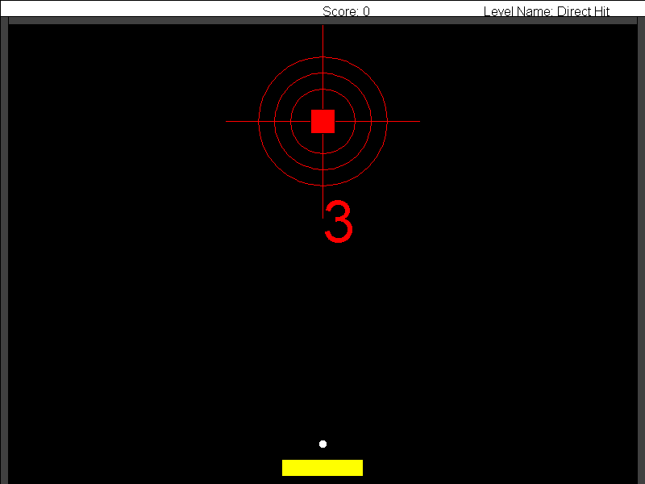
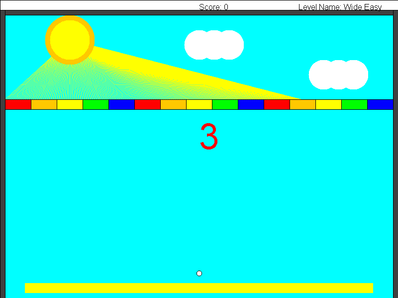
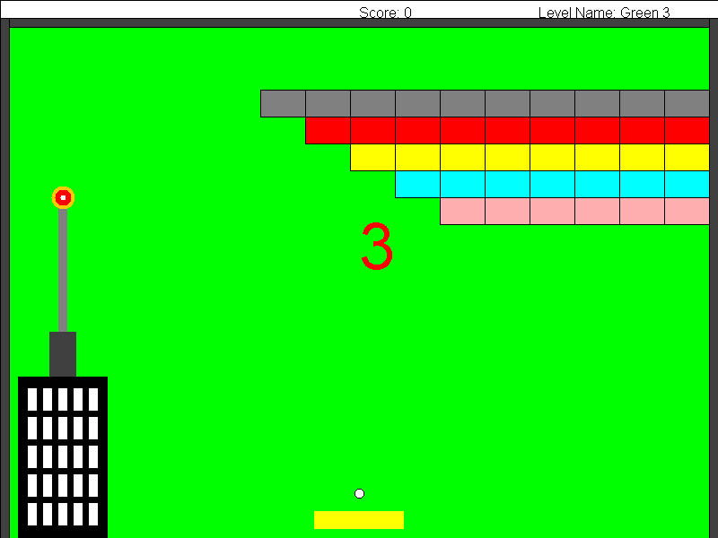

# Arkanoid

Arkanoid is a Java desktop brick-breaker. Move the paddle to keep the ball in play, break the blocks, and clear three levels. Each level has its own layout, paddle size, and starting ball velocities.

## Screenshots

| Direct Hit | Wide Easy | Green 3 |
| --- | --- | --- |
|  |  |  |

## Run the game

Install a JDK and make sure both `java` and `javac` are on your PATH. The game uses the bundled `biuoop-1.4.jar` for its window, drawing, and keyboard input.

Open a terminal in the project folder and run the command for your platform.

**Windows (PowerShell)**

```powershell
.\run-windows.bat
```

**macOS or Linux**

```sh
sh run-linux-mac.sh
```

The game plays all three levels by default. Pass level numbers to choose what to play, for example `sh run-linux-mac.sh 2 3` or `.\run-windows.bat 2 3`.

In VS Code, open the project folder with Java support enabled, then click **Run** above `main` in `src/Ass6Game.java`. In IntelliJ IDEA, use the included **Arkanoid (all 3 levels)** run configuration.

## Controls

| Key | Action |
| --- | --- |
| ← / → | Move the paddle |
| P | Pause |
| Space | Resume or close the end screen |

## How it works

- `Ass6Game` selects the levels and starts `GameFlow`, which runs the levels in order.
- `GameLevel` manages the paddle, balls, blocks, score, and level state. `AnimationRunner` drives the frame loop.
- `GameEnvironment` checks the ball's path for collisions. Hit listeners remove blocks or lost balls and update the score.
- `Level1`, `Level2`, and `Level3` define the starting state and background for each level.
